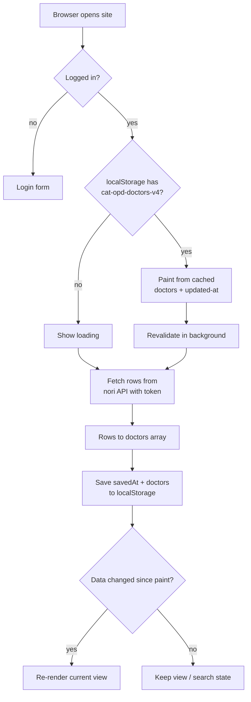

# ตารางออกตรวจ (cat-opd-schedule-site)

Single-file Thai OPD doctor schedule PWA. Data source: the nori API (`/api/tables/schedule/rows`), behind a login.

## How it works

- `config.json` holds the API URL, table name, day names, and day display order. Fetched at startup.
- Login only (no registration): `POST /api/login` returns a session token kept in `localStorage`, sent as `Authorization: Bearer`. A 401 clears the session and returns to the login form; logout revokes the token and clears the cached data. Accounts are created by the nori admin. Do not put an API key in this site.
- Roles (from the login response): `viewer` is read-only. `editor` and `admin` can also add (`#new`), edit (`#edit/<id>`) and delete doctors, via `POST`/`PATCH`/`DELETE` on the rows endpoints. `builder` is outside nori's `admin > editor > viewer` hierarchy and gets 403 on rows, so the site shows a "no access" message.
- Every page has a top bar with `username · role` linking to `#profile` (account info, time of this sign-in kept client-side, and change password via `POST /api/me/password`) plus logout.
- Views switched by URL hash: search list, per-doctor weekly table with today highlighted. Doctor ids are `d` + djb2 hash of the doctor name.
- Caches: `localStorage` (parsed doctors + update time), service worker (app shell).

## Data flow



## Run

```bash
python3 -m http.server 8000
# open http://localhost:8000
```
