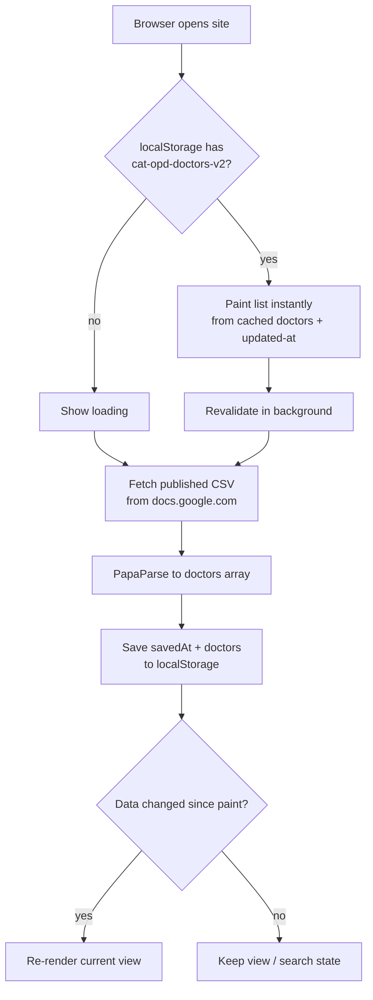

# ตารางออกตรวจ (cat-opd-schedule-site)

Single-file Thai OPD doctor schedule PWA. No backend, no build step. Data comes from a published Google Sheet.

## How it works

- `config.json` holds the CSV link, day names (the sheet's column names), and day display order — fetched at startup, no code edits needed to retarget.
- Two views switched by URL hash: search list and per-doctor weekly table with today highlighted. Doctor ids are name hashes, so shared links survive row reordering in the sheet.
- Three caches make repeat loads fast and offline-friendly: browser HTTP cache (CSV, 5 min), `localStorage` (parsed doctors + update time), service worker (app shell).

## Data flow



## Run

```bash
python3 -m http.server 8000
# open http://localhost:8000
```
