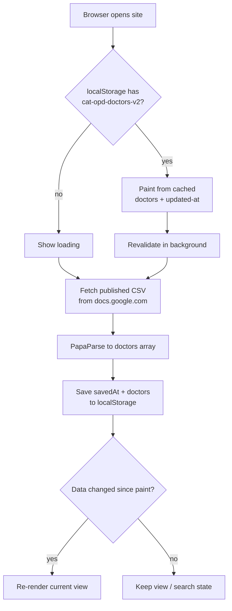

# ตารางออกตรวจ (cat-opd-schedule-site)

Single-file Thai OPD doctor schedule PWA. Data source: a published Google Sheet.

## How it works

- `config.json` holds the CSV link, day names, and day display order. Fetched at startup.
- Two views switched by URL hash: search list, per-doctor weekly table with today highlighted. Doctor ids are `d` + djb2 hash of the doctor name.
- Caches: browser HTTP cache (CSV, 5 min), `localStorage` (parsed doctors + update time), service worker (app shell).

## Data flow



## Run

```bash
python3 -m http.server 8000
# open http://localhost:8000
```
