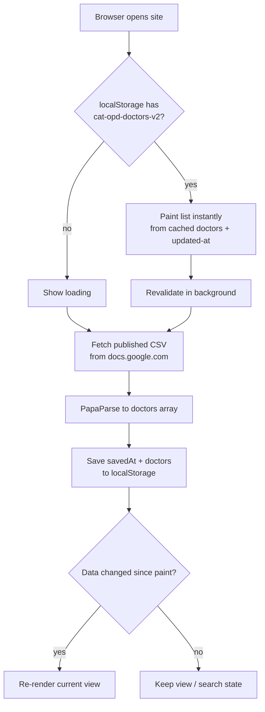

# ตารางออกตรวจ (cat-opd-schedule-site)

Single-file internal tool for looking up doctors' OPD schedules. Thai-language, no backend, no build step — everything lives in `index.html` plus PWA assets.

## How it works

- **Data source** — a published Google Sheet (`File > Share > Publish to web`, CSV output). The sheet is the single source of truth; the site only reads it.
- **Configuration** — `config.json` holds the CSV link, Thai day names (also the sheet's column names), and day display order. Fetched at startup; change the file, no code edits.
- **Render** — vanilla JS, no framework. Two views switched by URL hash: `#` shows the search list, `#<doctorId>` shows one doctor's weekly table with the current day highlighted. Doctor ids are hashes of the doctor's name (`d` + djb2), so shared links survive row reordering in the sheet; only a rename changes an id.
- **Search** — free-text over name/department plus department filter chips. State lives in memory, so a background data refresh never wipes what you typed.

## Data flow



Three caching layers sit in front of the sheet:

| Layer | Caches | Lifetime |
|---|---|---|
| Browser HTTP cache | the CSV response (Google sends `max-age=300`) | 5 min |
| `localStorage` (`cat-opd-doctors-v2`) | parsed doctors + `savedAt` timestamp | until replaced |
| Service worker (`cat-opd-shell-v2`) | app shell, PapaParse, font CSS | until cache version bump |

## Offline behavior

The service worker (`sw.js`) serves the shell (network-first for pages, stale-while-revalidate for assets) and stays out of the CSV request entirely. Fully offline: shell comes from the worker cache, doctor data comes from `localStorage`, and the header shows the last successful update time.

## Run locally

```bash
python3 -m http.server 8000
# open http://localhost:8000
```

(The page itself is a single file, but the service worker and CSV fetch need an http origin.)

## Test

```bash
bash test.sh   # 19 checks via agent-browser: render, cache-first paint,
               # background revalidate, hash routing, PWA, offline reload
```

## Files

```
index.html            the whole app (markup, styles, logic)
config.json           runtime config: CSV link, day names, day order
manifest.webmanifest  PWA manifest (name, icons, standalone display)
sw.js                 service worker: app-shell cache
icon.svg              favicon source (Twemoji cat face on white box)
icon-maskable.svg     maskable icon source
icon-*.png            generated icons (192/512/180/maskable-512)
test.sh               regression suite
```

## Deploy

Not deployed yet. Any static host over HTTPS works (e.g. GitHub Pages) — HTTPS is what makes the PWA installable.
